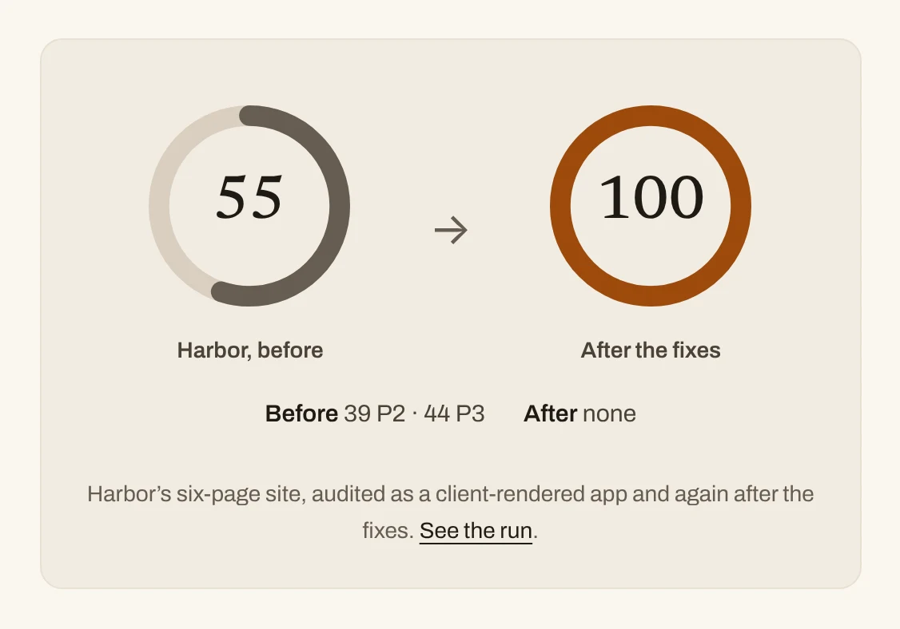
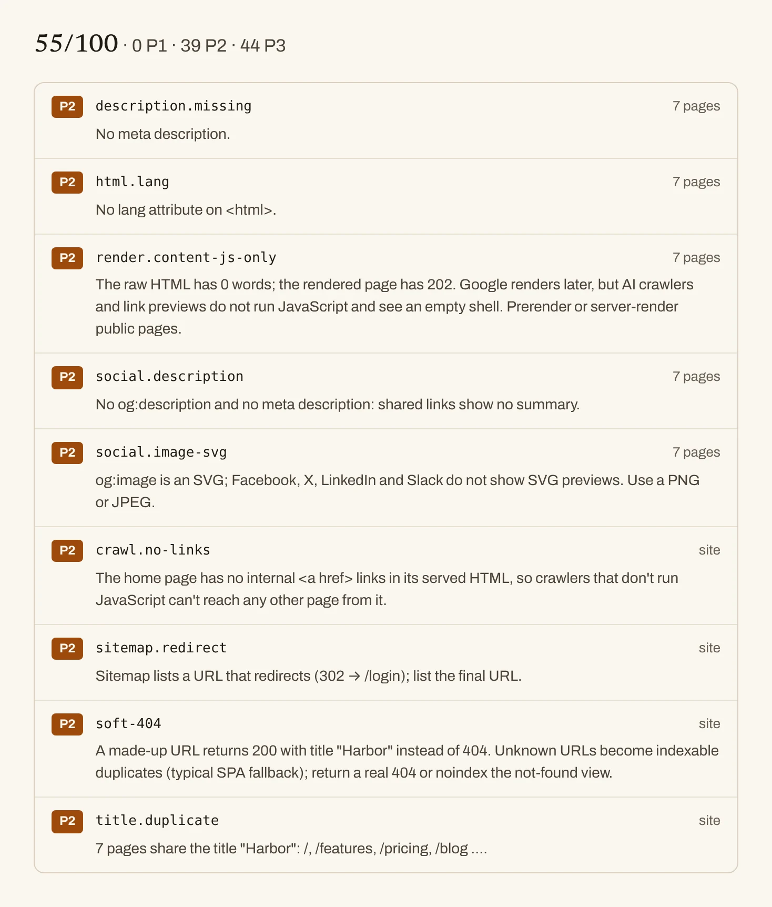
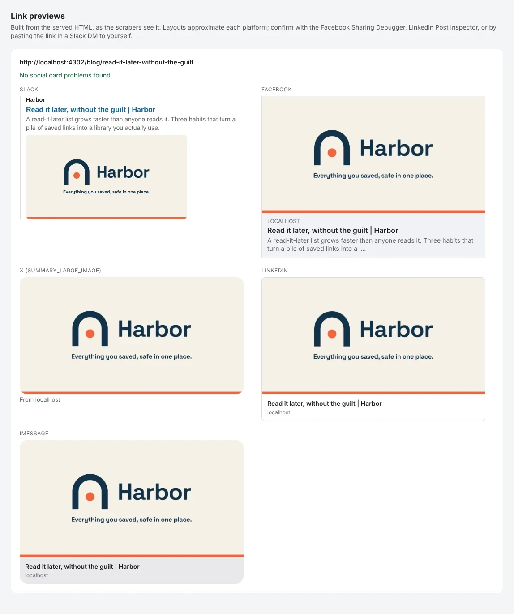
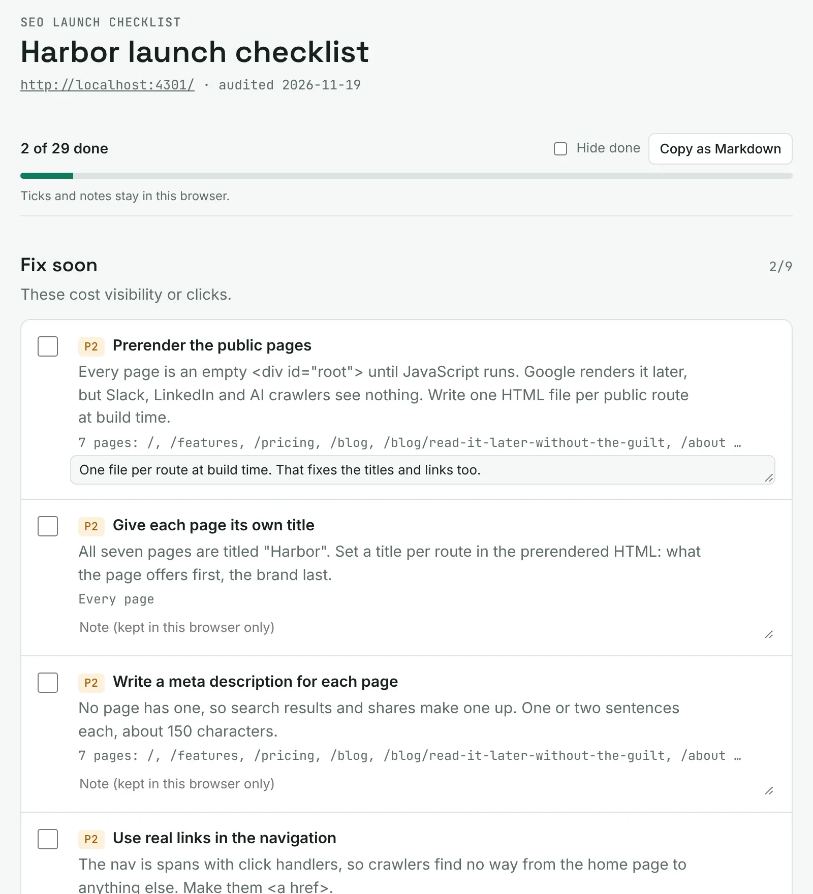

<p align="center">
  <a href="https://mattblack.space/skills/crawlspace/">
    <picture>
      <source media="(prefers-color-scheme: dark)" srcset=".github/readme/logo-dark.svg" />
      
    </picture>
  </a>
</p>

<h3 align="center">SEO audits that show their evidence.</h3>

<p align="center">
  A Claude Code plugin that audits a site against the HTML its server really sends and the code that sends it.<br />
  Graded findings, a launch checklist, previews of every shared link, and fixes when you ask. No paid tools or API keys.
</p>

<p align="center">
  <a href="https://mattblack.space/skills/crawlspace/"><b>Website</b></a> ·
  <a href="#install">Install</a> ·
  <a href="#skills">Skills</a> ·
  <a href="#the-checker">The checker</a> ·
  <a href="skills/audit/checklist.md">Audit checklist</a> ·
  <a href="CHANGELOG.md">Changelog</a>
</p>

<p align="center">
  <a href="LICENSE"></a>
  <a href="CHANGELOG.md"></a>
  <a href="https://github.com/mtblck/claude-marketplace"></a>
  <a href="#the-checker"></a>
  <a href="https://mattblack.space/skills/crawlspace/"></a>
</p>

<p align="center">
  <a href="https://mattblack.space/skills/crawlspace/#how">
    <picture>
      <source media="(prefers-color-scheme: dark)" srcset=".github/readme/hero-dark.webp" />
      
    </picture>
  </a>
</p>
<p align="center"><sub>Harbor, a made-up six-page app, audited as a client-rendered site and again after its fixes. <a href="https://mattblack.space/skills/crawlspace/#how">See the whole run</a>.</sub></p>

## What it does

Ask Claude to check a site's SEO and you usually get general tips that could describe any site.
Crawlspace finds the problems this site actually has and proves each one: the URL, what the server
sent, and the line of code that caused it.

It fetches every page the way a crawler does and again in a real browser, compares the two, and
reads the repo that made them. That catches what single-page apps get wrong: one title on every
page, an empty shell where the content should be, made-up URLs that answer 200, share cards nobody
can see. Every finding is verified before it is graded **P1** (blocks indexing), **P2** (costs
visibility or clicks) or **P3** (polish). Nothing changes unless you ask for fixes.

<p align="center">
  <picture>
    <source media="(prefers-color-scheme: dark)" srcset=".github/readme/findings-dark.webp" />
    
  </picture>
</p>

Built for Vite and React single-page apps and Next.js on Vercel, and works on any site. In
Claude's cloud sandbox, where the live site is often out of reach, it audits a local production
build instead and says which checks that skips.

## Install

In Claude Code (2.1.275 or later):

```
/plugin install crawlspace --marketplace mtblck/crawlspace
```

Or add the marketplace first, which works on older versions too:

```
/plugin marketplace add mtblck/crawlspace
/plugin install crawlspace@crawlspace
```

To have it in every session on a repo (including Claude Code on the web and the Claude GitHub
Action), commit this as the repo's `.claude/settings.json`:

```json
{
  "extraKnownMarketplaces": {
    "crawlspace": { "source": { "source": "github", "repo": "mtblck/crawlspace" } }
  },
  "enabledPlugins": { "crawlspace@crawlspace": true }
}
```

It's also in [mtblck/claude-marketplace](https://github.com/mtblck/claude-marketplace) as
`crawlspace@mtblck`. Until 2.0.0 it lived there as the `seo` plugin, so `/seo:audit` is now
`/crawlspace:audit`.

## Skills

| Skill | Use it for |
| --- | --- |
| `/crawlspace:audit [url \| route \| fix]` | Full audit: crawl and index controls, metadata and canonicals, sitemaps, raw vs rendered HTML, links, structured data, Core Web Vitals, content and E-E-A-T, AI search. Verified findings graded P1/P2/P3, a technical score, `SEO-AUDIT.md`, and an interactive launch checklist to tick off. With `fix`, fixes shared code first and re-measures. |
| `/crawlspace:page <url \| route> [query]` | One page against the query it should win and the pages that rank for it: intent, title and description options, content gaps, internal links. |
| `/crawlspace:schema [url \| route] [type]` | Find, validate and write schema.org JSON-LD the way the stack does head content. |
| `/crawlspace:social [url ...]` | Social cards and link previews: OG and Twitter tags on every page, the share image fetched and measured, and a picture of how the link unfurls on Slack, Facebook, X, LinkedIn and iMessage. |
| `/crawlspace:keywords [url \| topic] [competitors]` | Keyword research without paid tools: queries from the site, search results, People Also Ask, forums and Search Console data, one primary query per page, cannibalisation and gaps, `keywords.md` and a CSV. |
| `/crawlspace:search-console [exports]` | Google's own numbers, from a Search Console export or MCP server: striking-distance queries, low CTR for the position, real cannibalisation, why clicks dropped (ranking, demand or CTR), indexing states, and checker findings on pages that already get impressions. |
| `/crawlspace:links [url]` | Internal linking plan from the real link graph: orphans, buried pages, pages with one link or none, vague anchors, missing hubs, and specific links to add (source, anchor, target), using the keyword map when there is one. |
| `/crawlspace:ai-search [url]` | AI crawler access, pages that work without JavaScript, quotable content, entity clarity, llms.txt, each call labelled documented or judgement. |

Claude also picks them up from their descriptions: "why isn't this page indexed?", "check how this
link looks on Slack".

## The checker

`scripts/seo-check.mjs` is the evidence collector the skills share. It needs Node 18 or newer and
nothing else, and renders pages with Playwright when Playwright is already installed. It only sends
GET requests to the site it's pointed at, plus any old URLs you list with `--redirects`.

```
node scripts/seo-check.mjs --url https://example.com --max 30 --md seo.md --json seo.json
node scripts/seo-check.mjs --url http://localhost:4173   # a local build
node scripts/seo-check.mjs --url https://example.com --crawl 300   # also walk links: depth, orphans, inbound links, anchors, URL hygiene
node scripts/seo-check.mjs --url http://localhost:4173 --baseline seo.json   # what regressed since an earlier run
node scripts/seo-check.mjs --url https://new.example.com --redirects old-urls.csv   # after a migration
```

It reads robots.txt (RFC 9309 matching, with an access table for search engines,
AI search fetchers, training crawlers and control tokens), the sitemap or sitemap
index, and an even sample of sitemap URLs (or a crawl from the home page), then
checks status codes, redirects, noindex in sitemaps, titles and descriptions
(missing, length, duplicates), canonicals and their targets, `lang`, viewport,
headings, images, JSON-LD parsing, Open Graph and Twitter card tags (fetching each share
image to check its status, type, file size, pixel size and ratio), mixed content, hreflang
codes and return links, internal link status, favicons, apple-touch-icon, manifest and
theme-color, soft 404s, http → https and www/apex consolidation (live sites only), and what only appears after JavaScript runs.
It exits 1 when there's a P1, so it can gate a deploy.

With `--baseline earlier.json` it fetches every page of that earlier run again and grades regressions
as `drift.*` findings: pages that stopped answering 200, turned noindex, moved their canonical away or
lost their share image, structured data or most of their words, search crawlers newly blocked, and a
shrinking sitemap. Title, description and H1 changes are listed for a person to confirm. Pages match
by path, so a production run can be the baseline for a local build or a preview deploy.
After a migration or a URL change, `--redirects FILE` checks every old URL: a text or CSV file of
old URLs or paths (optionally `old,new` to say where each should land) or the old `sitemap.xml`. Each
must 301 or 308 in one hop to a page that answers 200, is indexable and is its own canonical. It
flags missing redirects, temporary ones, chains, loops, redirects to the home page and wrong targets.

The score deducts once per kind of problem (P1 12, P2 4, P3 1). It's a gauge for
comparing runs, not a ranking prediction.

### Link previews

`scripts/social-preview.mjs --url <page> [--url ...] --out <dir>` draws how each page unfurls on
Slack, Facebook, X, LinkedIn and iMessage (HTML, plus a PNG with Playwright), from the served HTML
only, the way the scrapers see it. The layouts are close approximations, not pixel copies.

<p align="center">
  
</p>

### Field Core Web Vitals

`scripts/field-cwv.mjs --url <page> [--url ...]` gets real-user LCP, INP and CLS (Chrome UX Report,
75th percentile) for each page and its whole origin from Google's PageSpeed Insights API, and says
which pass. It contacts Google, not your site. It works without a key at a small shared quota; set
`PAGESPEED_API_KEY` for more.

### Search Console rows

`scripts/gsc.mjs --rows now.csv [--previous before.csv] [--checker seo.json]` reads Search Console
performance rows (the UI export's `Queries.csv` and `Pages.csv`, or query + page rows from the API, an
MCP server, Sheets or BigQuery) and lists striking-distance queries, low CTR judged against the site's own
CTR at that position, cannibalisation, lost clicks with the number that moved, and checker findings on pages
that get impressions. It reads files only and calls no API.

### Launch checklist

`scripts/checklist.mjs --from seo.json --out <dir>` turns a checker run into an interactive launch
checklist (`templates/checklist.html` plus `checklist.json`): fixes grouped by priority, the
set-up-once steps, ticks, dates and notes, and "Copy as Markdown". Published as an Artifact, ticks
save into the page; re-runs carry ticks over and move fixed items to their own section.

<p align="center">
  <picture>
    <source media="(prefers-color-scheme: dark)" srcset=".github/readme/checklist-dark.webp" />
    
  </picture>
</p>

## How the repo is laid out

```
skills/      audit, page, schema, social, keywords, ai-search (each a SKILL.md)
scripts/     seo-check.mjs (the checker), social-preview.mjs, checklist.mjs, lib/, test/
templates/   checklist.html and an example checklist.json
```

Test the checker with `node --test "scripts/test/*.test.mjs"`: it serves a fixture site with
planted problems on localhost. CI runs that and `claude plugin validate .` on every pull request.

## Prior art

Built after a survey of the SEO skills on GitHub on 2026-11-11. Nothing was
copied; the ideas taken are listed in [THIRD_PARTY_NOTICES.md](THIRD_PARTY_NOTICES.md).

| Project | License | Taken | Left |
| --- | --- | --- | --- |
| [AgriciDaniel/claude-seo](https://github.com/AgriciDaniel/claude-seo) | MIT | Fetched content as untrusted data; audit split into parallel specialist passes; P1-style priority definitions; error handling for unreachable sites | 26 skills, 19 agents, a Python runtime with ~20 packages, paid-API extensions and a PostToolUse hook: far more than these repos need |
| [coreyhaines31/marketingskills](https://github.com/coreyhaines31/marketingskills) `seo-audit`, `schema`, `ai-seo` | MIT | Priority order (crawl → technical → on-page → content → authority); "raw fetch can't see JS-injected schema"; issue / evidence / fix report shape | Marketing-agency framing and questionnaires; no measurement |
| [umutxyp/Seo-Promt-Master](https://github.com/umutxyp/Seo-Promt-Master) | MIT | Read the code *and* fetch the served site; classify routes public-index / public-noindex / private; fix shared infrastructure first; prove fixes by re-fetching | Its 1,600-line CLI and 18-file knowledge base: a smaller original checker with a render pass fits these repos better and needs no vendoring |
| [addyosmani/web-quality-skills](https://github.com/addyosmani/web-quality-skills) `seo` | MIT | Don't invent ranking weights; a Lighthouse SEO score is a subset; separate crawl/index from content quality | Overlaps `pr-review:performance` and `accessibility` |
| [inhouseseo/superseo-skills](https://github.com/inhouseseo/superseo-skills) `page-audit` | Apache-2.0 | Single-page review against the live top results; never infer what an unread competitor page says | Content-writing and link-building skills |
| [zubair-trabzada/geo-seo-claude](https://github.com/zubair-trabzada/geo-seo-claude) | MIT | AI crawler tiers (search vs training) | Agency sales features (prospects, proposals, CRM); unsourced statistics |
| [JeffLi1993/seo-audit-skill](https://github.com/JeffLi1993/seo-audit-skill) | MIT | (nothing new) | Lighter subset of the above |

## Changelog

What changed in each release is in [CHANGELOG.md](CHANGELOG.md).

## License

[MIT](LICENSE) © Matt Black
